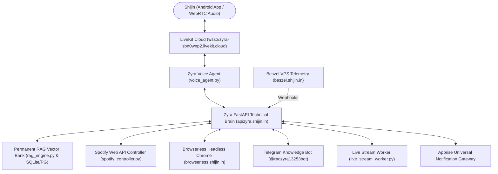

# 🌟 Zyra — Technical AI Companion & Intelligence Ecosystem

Zyra is a high-performance, real-time AI companion, voice assistant, and personal intelligence network built for Shijin. Zyra integrates deep conversational memory (RAG), hands-free Spotify music control, headless dynamic web crawling, 24/7 live video stream intelligence, infrastructure telemetry, and multi-channel instant notifications.

---

## 🏗️ System Architecture & Services



---

## 🗺️ Core Ecosystem Capabilities

| Capability | Component | Endpoint / Service | Status |
| :--- | :--- | :--- | :--- |
| **🧠 Lifetime Memory & RAG** | Vector Memory + Telegram Ingest | `https://apizyra.shijin.in/rag` & `@ragzyra13253bot` | 🟢 Verified Live |
| **🎵 Spotify Music Control** | Spotify Web API OAuth | `https://apizyra.shijin.in/spotify` | 🟢 Authorized |
| **🌐 Dynamic Web Scraping** | Headless Chromium | `https://browserless.shijin.in` | 🟢 Verified Live |
| **🖥️ VPS Telemetry & Health** | Beszel Hub & Agent | `https://beszel.shijin.in` (Port 8090) | 🟢 Monitoring Live |
| **🔔 Instant Notifications** | Apprise + Webhook Receiver | `https://apizyra.shijin.in/alerts` | 🟢 Multi-channel Ready |
| **📱 Android Native Actions** | LiveKit WebRTC + Native Calls | Android App + `my_contacts.vcf` | 🟢 Connected |
| **📺 Live Stream Intelligence**| Audio Slicing & Ticker Poller | `https://apizyra.shijin.in/live-news` | 🟢 Active |
| **⏱️ Uptime Monitoring** | Uptime Kuma | `https://uptime.shijin.in` (Port 3001) | 🟡 Setup Ready |
| **🔍 Webpage Change Tracker** | Changedetection.io + Browserless | `https://change.shijin.in` (Port 5000) | 🟡 Setup Ready |
| **🛡️ OSINT & Site Recon** | Web Check Security Analyzer | `https://webcheck.shijin.in` (Port 3000) | 🟡 Setup Ready |

---

## 📡 Live Stream Intelligence & News Feeds

Zyra continuously monitors **400+ curated intelligence sources** across 20+ specialized domains:
1. **Malayalam Live TV News**: Asianet News, Manorama News, Mathrubhumi, 24 News, MediaOne, Reporter TV.
2. **Indian National & World News**: NDTV, India Today, WION, DD News, Reuters, BBC, AP News.
3. **Cybersecurity & Threat Intel**: The Hacker News, BleepingComputer, Krebs, SANS ISC, Unit 42, Talos.
4. **Real-Time CVE Intelligence**: CISA Known Exploits Catalog (KEV), NIST NVD, AttackerKB, Exploit-DB, VulnCheck.
5. **Longform Podcasts**: The Malayali Podcast, BeerBiceps (TRS), WTF is? (Nikhil Kamath), Raj Shamani.
6. **Sports Live**: Cricbuzz Live, ESPNcricinfo, Kerala Blasters FC, ISL, FIFA, Formula 1, FanCode.
7. **Malayalam Literature & Free Books**: Sayahna Foundation, DC Books, Pratilipi, Project Gutenberg.
8. **Music Streaming & Malayalam Labels**: Spotify, Muzik247, Satyam Audios, Kappa TV Music Mojo, Wonderwall.

> For the complete 400-source directory with direct streaming links, see **[docs/ZYRA_INTELLIGENCE_FEEDS.md](docs/ZYRA_INTELLIGENCE_FEEDS.md)**.

---

## 🔌 API Endpoints Reference (`https://apizyra.shijin.in`)

### Core & Diagnostics
* `GET /health` — Brain & PostgreSQL connection status
* `POST /token` — Generates LiveKit WebRTC tokens for Android companion

### Permanent RAG & Knowledge Hub
* `GET /rag/memories` — Inspect lifetime stored conversation turns & ingested documents
* `POST /rag/query` — Semantic vector search with hybrid lexical boost
* `POST /rag/remember` — Stores a single conversation fact or preference
* `POST /rag/upload-pdf` — Extracts, chunks, embeds, and indexes multi-page PDF documents

### Spotify Music Playback
* `GET /spotify/status` — Current playback state and authorization check
* `GET /spotify/login` — Initiates Spotify OAuth login
* `GET /spotify/callback` — OAuth callback endpoint

### Dynamic Browsing & Tools
* `POST /tools/browse` — Uses Browserless headless Chrome to fetch live JavaScript-rendered pages
* `POST /alerts/incoming` — Receives system alerts (Beszel/OCI) and forwards to Discord, Telegram, and RAG

### Live Stream Intelligence
* `GET /live-news/channels` — Lists monitored YouTube live streams
* `POST /live-news/refresh` — Triggers real-time title and breaking news ticker extraction into RAG

---

## ⚙️ Environment Variables (Coolify)

```env
# LiveKit WebRTC Voice Engine
LIVEKIT_URL=wss://zyra-sbn0wnp2.livekit.cloud
LIVEKIT_API_KEY=APIu87a4sL8Qf2P
LIVEKIT_API_SECRET=qL07Ecm1kY9jXWqfM8N5p0K3xR6tU2vB
GEMINI_API_KEY=AIzaSy...

# Telegram Knowledge Ingestion Bot
TELEGRAM_BOT_TOKEN=8945956178:AAFeDasLqCAnGO-rWwDFVgS_7drGaebdsaE
AUTHORIZED_TELEGRAM_USERS=5423604085

# Spotify Web API
SPOTIFY_CLIENT_ID=18afa2a734744db9a76fb0fbd2e188ed
SPOTIFY_CLIENT_SECRET=188304993d4b4ed5b98bfe401b3297f3
SPOTIFY_REDIRECT_URI=https://apizyra.shijin.in/spotify/callback

# Browserless Headless Chrome
BROWSERLESS_URL=https://browserless.shijin.in
BROWSERLESS_TOKEN=km6Gy3562QXPWZJB7a8mZenXVR6Xyn9c

# Apprise Gateway
APPRISE_API_URL=http://apprise:8000
```

---

## 📜 Documentation Index
* **[Master Feed Directory (400+ Sources)](docs/ZYRA_INTELLIGENCE_FEEDS.md)**
* **[Live Stream Architecture & Audio Slicing](docs/LIVE_STREAM_INTELLIGENCE.md)**
* **[Ecosystem Testing & Verification Checklist](docs/ECOSYSTEM_CHECKLIST.md)**
