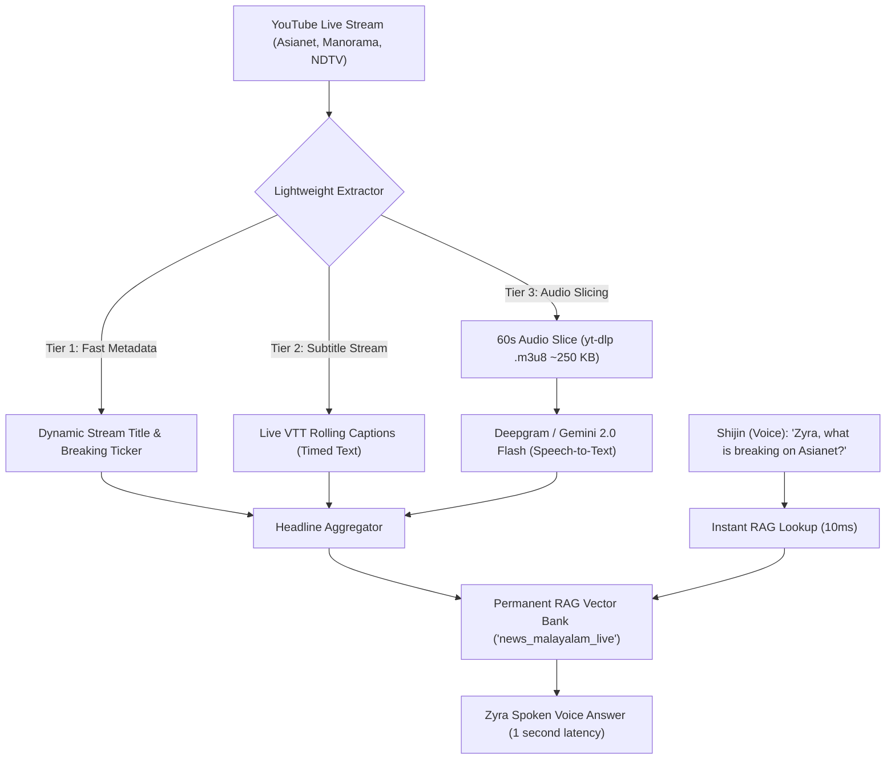

# Zyra Live Video & Stream Intelligence Architecture

This document explains how Zyra extracts real-time intelligence from **24/7 Live YouTube News Streams** (such as Asianet News Live, Manorama News, NDTV 24x7) and indexes breaking news into the **RAG Vector Memory Bank** without downloading heavy video files.

---

## 🎯 1. Why Live Video Streams Help Zyra

* Breaking news (Kerala politics, weather emergencies, election tallies) appears on live TV **1 to 3 hours before** written articles or blogs are published.
* Anchors speak live as news breaks on the ticker.
* Publicly accessible 24/7 video and audio streams.

---

## 🏗️ 2. The Live Stream Extraction Pipeline

Processing full 1080p video would waste CPU and gigabytes of bandwidth. Zyra uses a **multi-tiered lightweight approach**:



---

## ⚙️ 3. How the 3 Extraction Routes Work Live

### Route 1: Live Title & Breaking News Ticker (Zero Bandwidth)
News channels constantly update their live stream titles and descriptions as breaking news occurs.
- Stream titled `Asianet News Live TV` changes to `Asianet News Live: Kerala Cabinet Decides New Policy / വാര്‍ത്തകള്‍ തത്സമയം`.
- Zyra checks it via Browserless every 2 minutes. Any title change triggers an instant headline memory update in RAG.

### Route 2: Live Captions / Timed Text
Major national channels (NDTV, BBC, DD News) broadcast real-time rolling subtitles via YouTube's `timedtext` API:
```python
caption_url = f"https://www.youtube.com/api/timedtext?v={video_id}&live=1"
```
The text stream is cleaned, deduplicated, and fed directly into RAG.

### Route 3: Audio-Only 60-Second Chunking (for Malayalam Channels without Captions)
Malayalam channels often do not have real-time English or Malayalam closed captions. Instead:
1. `yt-dlp` extracts the audio-only stream URL (`.m3u8` HLS playlist).
2. It fetches the last 60 seconds of audio (approximately **250 KB** of data).
3. The audio chunk is sent to Gemini 2.0 Flash or Deepgram Nova-2 with the prompt:
   > *"Extract breaking news bullet points and headlines from this Malayalam broadcast audio."*
4. The output is tagged and saved into RAG under `category="news_malayalam_live"`.
